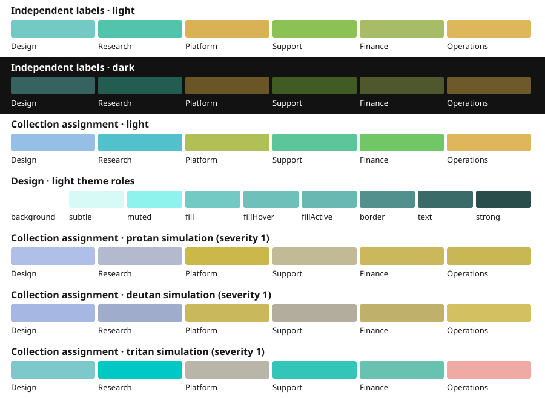

# TextHue

TextHue turns a text label into repeatable colors for light and dark themes. Use it for issue labels, avatars, or chart categories. An individual label keeps its colors across calls. When several labels appear together, collection assignment can move their colors farther apart.

[Try the live palette inspector](https://hustedev.github.io/texthue/site/?preview=2) · [Read the TextHue handbook](https://github.com/HusteDev/texthue/wiki) · [Run the inspector locally](docs/GUIDE.md#preview-a-collection-in-the-palette-inspector)

## One username across three apps

Follow `@mira` from the chat message to the task assignee and the on-call shift. Each app resolves the username independently. With the same TextHue version, settings, and theme, each gets exactly the same badge colors. Adding another teammate leaves Mira’s badge unchanged.



```js
import { resolveTextColors } from 'texthue';

const { fill, onFill } = resolveTextColors('@mira').light;
badge.textContent = '@mira';
badge.style.backgroundColor = fill.hex;
badge.style.color = onFill.hex;
```

## Start here

| What do you want to do? | Read |
| --- | --- |
| Install TextHue or find your language | [Package list, install commands, and first calls](docs/PACKAGES.md) |
| Choose colors for a group of labels | [Independent colors and collection assignment, illustrated](docs/COLORS.md#assigning-a-collection) |
| Keep existing colors when labels change | [Restore a registry and add a label](docs/GUIDE.md#restore-a-registry-and-add-a-label) |
| Understand a term in the inspector | [Glossary](docs/GLOSSARY.md) |
| Check how a palette looks with different color vision | [Vision profiles, illustrated](docs/GUIDE.md#find-labels-that-need-another-visual-cue) |
| Configure brand colors, contrast, or gamut | [Resolver configuration](docs/CONFIGURATION.md) |
| Develop or test an implementation | [Development guide](docs/DEVELOPMENT.md) and [algorithm specification](SPECIFICATION.md) |

## Sources and licensing

The project code is covered by [MIT](LICENSE); adapted W3C conversion code is covered by the [included W3C notice](THIRD_PARTY_NOTICES.md). Package metadata expresses both licenses. The [CSS Color 4 conversion algorithms](https://www.w3.org/TR/2026/CRD-css-color-4-20260901/#color-conversion-code) and [WCAG relative luminance definition](https://www.w3.org/WAI/WCAG22/Understanding/contrast-minimum.html) explain the underlying color and contrast calculations. The versioned local specification defines the implementation contract.
