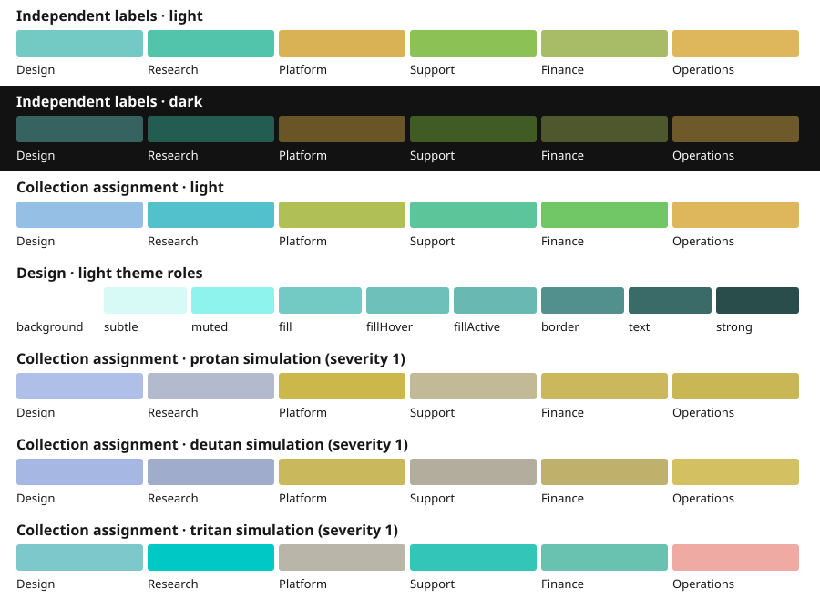

# Choose an assignment method

### The same username appears in three apps

Resolve the username independently in each app. With the same input, algorithm, settings, and [theme](GLOSSARY.md#theme-and-role), the badge has the same fill in all three places. Use the light theme’s `fill` for its background and `onFill` for the lettering, or take both roles from the dark theme.

### Several chart series look alike

Assign the visible series together. The [resolver](GLOSSARY.md#resolver) can move their colors farther apart because it knows which labels share the chart. Reordering the same set preserves the assignments. Changing the set can move an existing series.

### A new series must preserve last week’s colors

Save the [resolver](GLOSSARY.md#resolver) configuration and the [registry](GLOSSARY.md#registry) after assignment. Reload both, pass the saved placements as [pins](GLOSSARY.md#pinned-placements), and assign the updated collection. Save the new registry for the next run. [Registry walkthrough with code](GUIDE.md#restore-a-registry-and-add-a-label)

Compare the three methods side by side in [Using the palette inspector](INSPECTOR.md).
