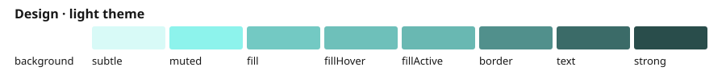
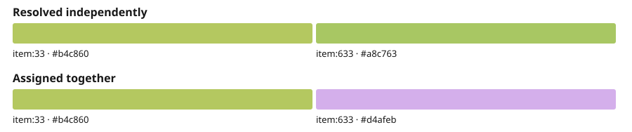

# Color results

Each [theme](GLOSSARY.md#theme-and-role) contains `background`, `subtle`, `muted`, `fill`, `onFill`, `fillHover`, `fillActive`, `border`, `text`, and `strong`. Use `fill` as a badge or surface background and `onFill` for its text. Use `text` for text or marks directly on the returned `background`. The application selects the theme. The strip shows the roles for a single label, including lighter surfaces and fills for hover and active states.



Every color has the same shape. For the default light fill for `research`:

```json
{
  "hex": "#59b8d8",
  "rgb": { "r": 89, "g": 184, "b": 216 },
  "hsl": { "h": 195.11811, "s": 61.95122, "l": 59.803922 },
  "oklch": { "l": 0.737459, "c": 0.100435, "h": 222.843011 }
}
```

RGB channels are integers from 0 through 255. HSL hue is in degrees and saturation/lightness are percentages. [OKLCH](GLOSSARY.md#color-formats) lightness is a fraction from 0 through 1, chroma is numeric, and hue is in degrees. Hex is lowercase six-digit sRGB. HSL and OKLCH numbers are rounded to six decimal places and describe the final RGB color, not the originally requested OKLCH coordinates.

Each theme reports seven contrast relationships: fill, hover and active against onFill, border against background, text against background and subtle, and strong against background. Check the selected model and pass flag before using a strict role. A supplied brand fill can report `palette-constraint`. Generated text can report `unattainable-contrast` when even the best endpoint misses the target. See the [result contract](../SPECIFICATION.md#result).

## Assigning a collection

**[Independent labels](GLOSSARY.md#independent-label-hash)** get their colors one at a time. Different names can land on nearly identical colors. **[Collection assignment](GLOSSARY.md#collection-assignment-assigned)** considers all the names you pass together and can adjust their colors so readers can tell them apart. Compare the same two labels in the rows below.



| Method | Inputs | Effect of adding a label |
| --- | --- | --- |
| Hash | One label and fixed options | Existing labels keep their colors. Nearby colors can occur. |
| [Brand palette](GLOSSARY.md#preset-and-brand-palette) | One label and a fixed set of named palette entries | Existing labels keep their entry. Multiple labels can share an entry. |
| Collection assignment | All labels shown together | Existing labels can move to improve separation. Reordering the same set preserves placements. |
| [Registry](GLOSSARY.md#registry) | New labels and saved placements from the same configuration | Pinned labels keep their placements. New labels use the remaining space. |

Use a configured [resolver](GLOSSARY.md#resolver) when the labels appear together. Assignment sorts normalized labels by digest, checks spacing around the hue circle, and uses additional lightness rings when the first ring fills. Persist the returned assignments to extend the collection later.

```typescript
const resolver = createResolver({ normalize: { unicode: 'NFC' }, namespace: 'issues' });
const first = resolver.assign(['bug', 'question', 'feature']);
const next = resolver.assign(['feature', 'question', 'bug', 'docs'], { pinned: first.assignments });
console.log(next.colors.docs.light.fill.hex, next.report.minDistance);
```

Python provides `Resolver.assign(texts, pinned=...)`. Go provides `NewResolver(WithNamespace("issues"))` and `resolver.Assign(texts, pinned)`. The report measures distance between rendered light fills in OKLab. Ring capacity describes the search space. Consumers can inspect the closest pair before relying on color to distinguish labels.

See the [registry walkthrough](GUIDE.md#restore-a-registry-and-add-a-label) to preserve placements.
