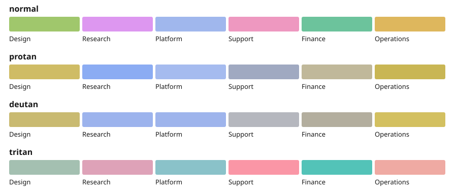

# Choosing and preserving label colors

New to the terminology? Look up [independent labels](GLOSSARY.md#independent-label-hash), [collection assignment](GLOSSARY.md#collection-assignment-assigned), or a [registry](GLOSSARY.md#registry).

| Workflow | Inputs | What happens when another label appears? | API |
| --- | --- | --- | --- |
| Independent identity | One label and stable options | Existing output stays fixed | `resolveTextColors(label, options)` |
| [Brand palette](GLOSSARY.md#preset-and-brand-palette) | Stable palette IDs and [theme](GLOSSARY.md#theme-and-role) fills | With the same palette, each label keeps its selected entry. Several labels can select one entry. | `createResolver({palette}).resolve(label)` |
| [Collection assignment](GLOSSARY.md#collection-assignment-assigned) | The complete set of visible labels | Recomputing with a changed set can move earlier labels. Reordering the same set preserves placements. | `assignTextColors(labels, options)` |
| Persistent [registry](GLOSSARY.md#registry) | New labels, saved placements, and matching configuration | [Pinned placements](GLOSSARY.md#pinned-placements) stay fixed across additions. Old placements continue to occupy space. | `resolver.assign(labels, {pinned})` |

## Preview a collection in the palette inspector

From the repository root, install the workspace dependencies and start the local preview.

```sh
npm ci
npm run site
```

Open `http://127.0.0.1:8000/site/`. Enter one label per line and select **Generate Palette**. The **Hash**, **Assigned**, and **[Registry](GLOSSARY.md#registry)** columns show the same labels under each assignment method. Expand **Fill attributes** for the current [theme](GLOSSARY.md#theme-and-role) or **Full color set** for the complete API result. Select the question mark beside a setting for its definition. The brand examples immediately regenerate the comparison with [Coastal duo (2 colors)](https://hustedev.github.io/texthue/site/?brand=duo) · [Print studio (4 colors)](https://hustedev.github.io/texthue/site/?brand=studio) · [Market stalls (8 colors)](https://hustedev.github.io/texthue/site/?brand=market). Switch themes to inspect both sets of fills. Select a [vision profile](GLOSSARY.md#vision-profile) to see its simulated colors. Enable **Optimize new placements** and inspect again to compare how the selected profile affects assignment.

To share your edits, select **Generate Palette**, wait for the updated results, then use [Copy link to this palette](INSPECTOR.md#copy-link-to-this-palette).

## Render a badge

Use the fill and its paired foreground from the same [theme](GLOSSARY.md#theme-and-role). For standalone text on the configured page background, use the text role.

```js
import { resolveTextColors } from 'texthue';

const {fill, onFill} = resolveTextColors('research').light;
console.log(fill.hex, onFill.hex);
```

## Find labels that need another visual cue

Read each column from top to bottom to follow one label. **Normal** shows the original fill. **[Protan](GLOSSARY.md#vision-profile)** simulates reduced sensitivity to red light, **deutan** to green light, and **tritan** to blue light. Look for labels that become hard to tell apart within a row. The simulation changes the preview while the application receives the original colors.



Open the illustrated labels in the inspector: [Normal](https://hustedev.github.io/texthue/site/?vision=normal) · [Protan](https://hustedev.github.io/texthue/site/?vision=protan) · [Deutan](https://hustedev.github.io/texthue/site/?vision=deutan) · [Tritan](https://hustedev.github.io/texthue/site/?vision=tritan).

Inspect final rendered fills for the [theme](GLOSSARY.md#theme-and-role) and vision profile used by your audience. The palette analysis returns indices in input order. Use that same order to recover the label names. Shape markers can repeat. Keep a visible text label when identity matters.

```js
import { createResolver } from 'texthue';
import { analyzePalette } from 'texthue/diagnostics';

const resolver = createResolver({namespace:'issues'});
const {colors, markers} = resolver.assign(['bug','feature','question'], {markers:true});
const labels = Object.keys(colors);
const {nearest} = analyzePalette(labels.map(label => colors[label].dark.fill.hex), 'deutan');
console.log(labels[0], markers[labels[0]], nearest[0].indices.map(i => labels[i]));
```

## Restore a registry and add a label

Store the exported configuration alongside the [registry](GLOSSARY.md#registry). An import checks their [fingerprints](GLOSSARY.md#fingerprint). Persist the registry returned after each successful update.

```js
import { createResolver, importConfig } from 'texthue';

const resolver = createResolver({namespace:'issues'});
const first = resolver.assign(['bug','feature']);
const snapshot = JSON.stringify({
  config:resolver.exportConfig(),
  registry:resolver.exportRegistry(first.assignments),
});
const saved = JSON.parse(snapshot);
const restored = importConfig(saved.config);
const pinned = restored.importRegistry(saved.registry);
const next = restored.assign(['question'], {pinned});
console.log(next.colors.question.light.fill.hex, Object.keys(next.assignments).length);
```

For component rendering, see the [React adapter](../packages/react/README.md). For build-time color utilities and runtime CSS variables, see the [Tailwind adapter](../packages/tailwind/README.md).

In JavaScript, pass `{vision:['normal','deutan']}` as the second argument to `resolver.assign` to rank candidate placements under both profiles. For each new identity the [resolver](GLOSSARY.md#resolver) considers up to 24 evenly spaced hue offsets, cycling through five lightness rings starting at the selected ring and maximizes the smallest rendered [OKLab distance](GLOSSARY.md#distance-and-contrast) across the requested profiles, both [themes](GLOSSARY.md#theme-and-role), and earlier placements. Simulations use full severity. Fixed brand colors and pinned registry entries participate in scoring and retain their placements. This bounded search adds rendering cost and can still produce close pairs.
