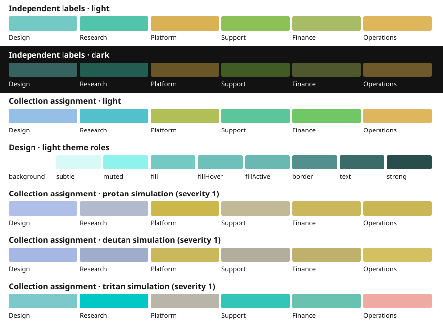

# TextHue for JavaScript and TypeScript



```js
import { assignTextColors, resolveTextColors } from 'texthue';

const research = resolveTextColors('research');
const issues = assignTextColors(['bug', 'question', 'feature']);
console.log(research.light.fill.hex, issues.colors.bug.light.fill.hex);
```

`texthue` turns exact text into repeatable light/dark color sets. One npm package supplies compiled ESM JavaScript and TypeScript declarations, with no runtime dependencies. It supports Node.js 20+ and browsers with TextEncoder. Resolution and input validation are synchronous.

For single-label rendering, import `resolveTextColor` or `resolveTextColors` from `texthue/single`. This entry loads the renderer without collection assignment, vision diagnostics, migration, registry fingerprinting, or CSS export modules.

To request one format, use `resolveTextColor('research', {theme: 'light', role: 'fill', format: 'hex'})`. It returns the string `#59b8d8`. A compiled resolver accepts the same selection in `resolver.color(label, selection)`. Omit `format` to get the complete color object.

```bash
npm install texthue
```

## Basic usage and every output format

```typescript
import { resolveTextColors } from 'texthue';

const colors = resolveTextColors('research');
const theme = colors.light; // Or colors.dark; your app chooses.
const { hex, rgb, hsl, oklch } = theme.fill;

console.log(hex);                                      // #59b8d8
console.log(`rgb(${rgb.r} ${rgb.g} ${rgb.b})`);          // rgb(89 184 216)
console.log(`hsl(${hsl.h} ${hsl.s}% ${hsl.l}%)`);         // hsl(195.11811 61.95122% 59.803922%)
console.log(`oklch(${oklch.l} ${oklch.c} ${oklch.h})`);   // oklch(0.737459 0.100435 222.843011)
console.log(theme.onFill.hex); // Text color for a surface using theme.fill.
console.log(theme.text.hex); // Text/marks on theme.background.
console.log(theme.background.hex);
console.log(theme.contrast.fill.ratio, theme.contrast.text.meetsTarget);
```

All four theme colors have these formats. RGB uses integer channels 0–255; HSL uses degrees and percentages; OKLCH uses fractional lightness, numeric chroma, and degrees. HSL/OKLCH describe the final RGB bytes and are rounded to six decimal places. CSS strings above use the right units; multiplying OKLCH lightness by 100 requires adding `%`.

## API and types

```typescript
function resolveTextColors(text: string, options?: TextColorOptions): ColorSet;
```

The library exports `VERSION` (`"text-to-color-v1"`), `TextColorError`, and the types `Range`, `ColorProfile`, `ThemeProfiles`, `TextColorOptions`, `RGB`, `HSL`, `OKLCH`, `Color`, `ContrastResult`, `ThemeColors`, `ColorSet`, and `TextColorErrorCode`.

```typescript
import { resolveTextColors, type TextColorOptions, type ColorSet } from 'texthue';

const options: TextColorOptions = {
  namespace: 'projects',
  profiles: { light: { fill: { chromaScale: [0.08, 0.12] } } },
};
const result: ColorSet = resolveTextColors('project-id:42', options);
console.log(result.version, result.hue, result.light.fill.hex);
```

`Range` is a readonly two-number tuple; `as const` tuples are accepted. Options are not mutated. Every call returns new result objects. Omit options or pass `undefined` for defaults; `null` is invalid. Plain objects and known keys are required. Runtime validation still applies in JavaScript and when TypeScript types are bypassed. Invalid inputs reject the promise with `TextColorError`, whose `code` is `INVALID_TEXT` or `INVALID_OPTIONS`.

## Every option

```typescript
const colors = resolveTextColors('project:atlas', {
  namespace: 'workspace:demo',
  backgrounds: { light: '#f5f0e8', dark: '#20242b' },
  contrastTarget: 7,
  profiles: {
    light: {
      fill:   { lightness: [0.74, 0.84], chromaScale: [0.08, 0.14] },
      text: { lightness: [0.40, 0.52], chromaScale: [0.60, 0.80] },
    },
    dark: {
      fill:   { lightness: [0.38, 0.48], chromaScale: [0.08, 0.14] },
      text: { lightness: [0.74, 0.86], chromaScale: [0.60, 0.80] },
    },
  },
});
console.log(colors.light.contrast, colors.dark.contrast);
```

| Option | Default | Rules |
| --- | --- | --- |
| `namespace` | `''` | Exact well-formed Unicode string; changes the hash |
| `backgrounds.light` | `'#ffffff'` | Six-digit hex `#RRGGBB`, no alpha |
| `backgrounds.dark` | `'#121212'` | Six-digit hex `#RRGGBB`, no alpha |
| `contrastTarget` | `4.5` | Finite number, 1–21 inclusive |
| `profiles.light.fill.lightness` | `[0.72, 0.82]` | Ordered pair in 0–1 |
| `profiles.light.text.lightness` | `[0.43, 0.53]` | Ordered pair in 0–1 |
| `profiles.dark.fill.lightness` | `[0.40, 0.50]` | Ordered pair in 0–1 |
| `profiles.dark.text.lightness` | `[0.72, 0.82]` | Ordered pair in 0–1 |
| Each role's `chroma` | `[0.60, 0.80]` | Ordered pair in 0–0.4 |

Omitted nested fields retain their defaults; supplied ranges replace both endpoints. Equal endpoints request a fixed value, including zero. Lightness can move outside its requested range to satisfy contrast, and chroma can decrease to fit sRGB. There are no other v1 tuning parameters.

```typescript
const gray = resolveTextColors('plain', {
  profiles: { light: { fill: { lightness: [0.75, 0.75], chromaScale: [0, 0] } } },
});
console.log(gray.light.fill.oklch.c); // 0

const impossible = resolveTextColors('project:atlas', {
  backgrounds: { light: '#777777' }, contrastTarget: 7,
});
console.log(impossible.light.contrast.text.meetsTarget); // false
console.log(impossible.light.contrast.text.fallback);   // unattainable-contrast
```

`contrast.fill` describes fill versus its black/white `onFill`. `contrast.text` describes text versus theme background. Both report `ratio`, `meetsTarget`, `lightnessAdjusted`, `chromaReduced`, and `fallback` (`null` or `"unattainable-contrast"`). A valid but impossible target returns an explicit failure result, not an exception. These pair measurements do not guarantee accessibility of an entire interface.

## Identity, normalization, and errors

```typescript
import { resolveTextColors, TextColorError } from 'texthue';

// A stable ID survives changes to a display name.
const stable = resolveTextColors('project-id:42', { namespace: 'projects' });
// If your product requires NFC normalization, apply it at every entry point.
const normalized = resolveTextColors('e\u0301'.normalize('NFC'));
console.log(stable.light.fill.hex, normalized.light.fill.hex);

try {
  resolveTextColors('research', { contrastTarget: 22 });
} catch (error) {
  if (error instanceof TextColorError) console.log(error.code); // INVALID_OPTIONS
  else throw error;
}
```

Case, whitespace, composed/decomposed Unicode, and namespace are significant. Empty text and embedded NUL are valid. Unpaired UTF-16 surrogates, non-string text, non-finite numbers, unknown keys, invalid ranges, and shorthand/alpha hex colors are rejected. Namespace is a domain separator, not a secret salt. Prefer stable non-secret identifiers; changing an access token changes its color. Different strings can still yield the same visible color.

## CommonJS and browsers

CommonJS applications can use dynamic import:

```javascript
async function main() {
  const { resolveTextColors } = await import('texthue');
  const colors = resolveTextColors('research');
  console.log(colors.light.fill.hex);
}
main().catch(error => { console.error(error); process.exitCode = 1; });
```

For a browser application, import `texthue` through your bundler. For the included standalone demo, build from the repository root, then run `python -m http.server 8000 --directory packages/npm`. Open `http://localhost:8000/examples/browser.html`. The demo imports the compiled local ESM files and shows theme selection, namespace, a fill/foreground pair, text text, and all result fields. It has no CDN dependency. Do not open it as a `file:` URL because browser module policies differ there.

## Algorithm and compatibility

The renderer hashes a seeded UTF-8 payload, interpolates between pinned hue anchors and samples gamut-relative chroma. Each theme returns ten roles. Contrast repair bisects a 1/4096 lightness grid and measures the final RGB bytes. See [the specification](SPECIFICATION.md) for tables, defaults and tie rules.

The [complete included specification](SPECIFICATION.md) defines every matrix, rounding rule, tie break, error, and fallback. The algorithm identifier `text-to-color-v1` is part of the hashed payload and is independent of the package version; it changes only when the color mapping changes. Hex/RGB match the Python and Go libraries for identical inputs/options. Derived color components permit a tolerance of one unit in the sixth decimal place across runtimes. The function is not a cryptographic hashing API or a guarantee of unique colors.

## Runnable examples and development

| File | Coverage |
| --- | --- |
| [basic.mjs](examples/basic.mjs) | Both themes, all four formats, fill and text roles |
| [tuning.mjs](examples/tuning.mjs) | Every option, fixed ranges, grayscale, impossible contrast |
| [identity.mjs](examples/identity.mjs) | Stable IDs, namespaces, exact text and normalization |
| [errors.mjs](examples/errors.mjs) | Invalid values and error codes |
| [commonjs.cjs](examples/commonjs.cjs) | Dynamic import from CommonJS |
| [typescript.ts](examples/typescript.ts) | Typed options, results, tuples and errors |
| [browser.html](examples/browser.html) | Interactive browser integration |

To work from a repository checkout, run `npm ci` and `npm run build` at the root; the examples then resolve the workspace package. `npm run test:types` checks the TypeScript example and public declarations without emitting files, `npm run examples --workspace texthue` executes the JavaScript examples, and `npm test` runs the conformance suite. `python tools/verify.py` additionally runs the Python and Go parity tests.

[MIT license](LICENSE). Adapted color conversions also carry the [W3C notice](THIRD_PARTY_NOTICES.md).
